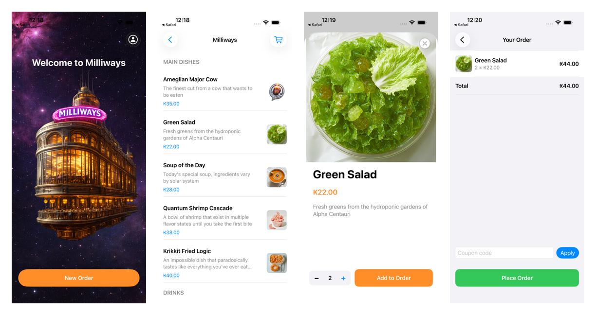
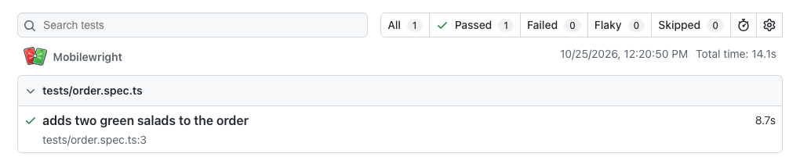

# From Mobile MCP to CI

Mobile MCP lets a coding agent such as Claude Code or Cursor drive an iOS simulator, an Android emulator or a real device. It is a good way to explore an app and check a flow by hand. An agent session is not a test, though: it costs tokens on every run and the agent can take a different path each time.

This guide turns one agent session into a [Mobilewright](https://mobilewright.dev/?utm_source=mobile-mcp&utm_medium=docs&utm_campaign=agent-to-ci) test that runs the same way every time, then runs that test in GitHub Actions on every pull request.

The examples use [Milliways](https://github.com/mobile-next/milliways-ios), our sample iOS app. Replace the bundle ID and the steps with your own app's.

## 1. Install Mobile MCP

In Claude Code:

```bash
claude mcp add mobile-mcp -- npx -y @mobilenext/mobile-mcp@latest
```

In Cursor, go to **Cursor Settings → MCP → Add new MCP Server**, choose the `command` type and use `npx -y @mobilenext/mobile-mcp@latest`.

Other clients and the full setup are in the [README](../README.md#installation-and-configuration).

Boot a simulator (or start an emulator, or plug in a device) and install your app on it. For Milliways, download `Milliways-simulator.zip` from the [latest release](https://github.com/mobile-next/milliways-ios/releases/latest), unzip it, and run:

```bash
xcrun simctl boot "iPhone 17 Pro"
xcrun simctl install booted Milliways.app
```

## 2. Let the agent explore the flow

Ask the agent to do the flow you want to cover, in plain words:

```text
Open Milliways on the iPhone simulator. Start a new order, add two Green Salads,
open the order and check that the total is ₭44.00.
```

The agent reads the screen through Mobile MCP's element list, taps by element, and reports what it saw at each step:



This is the time to fix the flow: if the agent gets stuck or the app misbehaves, you see it here, before any test code exists.

## 3. Ask for a Mobilewright test

In the same session, ask the agent to write down what it just did:

```text
Now write what you just did as a Mobilewright test in tests/order.spec.ts.
Use getByRole and getByText locators, not coordinates, and end with an
assertion on the order screen.
```

If the project does not use Mobilewright yet, the agent (or you) can add it first:

```bash
npm init mobilewright@latest
```

The agent already knows the labels and roles of every element it tapped, so the locators come straight from the session. For the flow above it writes:

`tests/order.spec.ts`:

```ts
import { test, expect } from '@mobilewright/test';

test('adds two green salads to the order', async ({ screen }) => {
  await screen.getByText('New Order').tap();
  await screen.getByText('Green Salad').tap();
  await screen.getByRole('button', { name: '+' }).tap();
  await screen.getByRole('button', { name: 'Add to Order' }).tap();

  await screen.getByRole('button', { name: /View Order/ }).tap();
  await expect(screen.getByText('Your Order')).toBeVisible();
  await expect(screen.getByText('2 × ₭22.00')).toBeVisible();
});
```

`mobilewright.config.ts`:

```ts
import { defineConfig } from 'mobilewright';

export default defineConfig({
  platform: 'ios',
  bundleId: 'com.mobilenext.Milliways',
  deviceName: /iPhone/,
});
```

Mobilewright waits for each element before acting on it, so there are no sleeps in the test. See [Locators](https://mobilewright.dev/docs/guides/locators) and [Assertions](https://mobilewright.dev/docs/guides/assertions) if you want to tighten what the agent wrote.

## 4. Run it locally

```bash
npx mobilewright test --reporter list,html
```

```
Running 1 test using 1 worker

  ✓  1 tests/order.spec.ts:3:5 › adds two green salads to the order (8.7s)

  1 passed (14.1s)
```

Open the report with `npx mobilewright show-report`:



From now on this flow runs in seconds, without an agent and without tokens. Keep using Mobile MCP to explore new flows and to debug a failing test, and ask the agent to update the test when the app changes.

## 5. Run it in GitHub Actions

Create `.github/workflows/mobilewright.yml`. Mobilewright does not boot a simulator for you, so the workflow boots one and installs the app before running the tests:

`.github/workflows/mobilewright.yml`:

```yaml
name: Mobilewright Tests
on:
  push:
    branches: [main]
  pull_request:
    branches: [main]

permissions:
  contents: read

jobs:
  ios:
    runs-on: macos-latest
    timeout-minutes: 30
    steps:
      - uses: actions/checkout@v4
      - uses: actions/setup-node@v4
        with:
          node-version: 24

      - run: npm ci

      - name: Boot a simulator and install the app
        run: |
          curl -sL -o Milliways-simulator.zip \
            https://github.com/mobile-next/milliways-ios/releases/latest/download/Milliways-simulator.zip
          unzip -q Milliways-simulator.zip
          xcrun simctl boot "iPhone 16 Pro"
          xcrun simctl install booted Milliways.app

      - name: Run Mobilewright tests
        run: npx mobilewright test --reporter list,html

      - uses: actions/upload-artifact@v4
        if: ${{ !cancelled() }}
        with:
          name: mobilewright-report
          path: mobilewright-report/
          retention-days: 30
```

Key points:

- **Your own app.** Replace the download step with however your build gets onto the runner: build it with `xcodebuild` for the simulator in an earlier step, or download it from your build job with `actions/download-artifact`. The `.app` must be a simulator build.
- **Simulator name.** `xcrun simctl list devices available` shows which simulators the runner image has. `deviceName: /iPhone/` in the config matches whichever iPhone is booted.
- **`if: ${{ !cancelled() }}`** uploads the report when tests fail, which is when you need it. Download it from the run summary and open it with `npx mobilewright show-report <folder>`.

### Android

For Android, run the emulator on a Linux runner with [android-emulator-runner](https://github.com/ReactiveCircus/android-emulator-runner), install your APK, and point a second config (or a [project](https://mobilewright.dev/docs/test/projects)) at `platform: 'android'` and your package name:

```yaml
  android:
    runs-on: ubuntu-latest
    timeout-minutes: 30
    steps:
      - uses: actions/checkout@v4
      - uses: actions/setup-node@v4
        with:
          node-version: 24

      - run: npm ci

      - name: Enable KVM
        run: |
          echo 'KERNEL=="kvm", GROUP="kvm", MODE="0666", OPTIONS+="static_node=kvm"' | sudo tee /etc/udev/rules.d/99-kvm4all.rules
          sudo udevadm control --reload-rules
          sudo udevadm trigger --name-match=kvm

      - name: Run Mobilewright tests on an emulator
        uses: reactivecircus/android-emulator-runner@v2
        with:
          api-level: 34
          arch: x86_64
          script: |
            adb install app-debug.apk
            npx mobilewright test --config mobilewright.android.config.ts
```

## Tips for prompts

- **Name the end state.** "Check that the total is ₭44.00" gives the test a real assertion. "Add a salad" gives it nothing to check.
- **Ask for role and text locators.** The agent sees coordinates too. Coordinates break on the next screen size; `getByRole` and `getByText` don't.
- **One flow per test.** Ask for a separate test per flow instead of one long script, so a failure points at one thing.
- **Run it before you commit it.** Ask the agent to run `npx mobilewright test` and fix the test until it passes.

## See also

- [Setting up CI](https://mobilewright.dev/docs/getting-started/ci)
- [Agent CLI](https://mobilewright.dev/docs/agent-cli/introduction), a shell alternative to Mobile MCP for agents
- [Codegen](https://mobilewright.dev/docs/guides/codegen), to record a test by clicking instead of prompting
